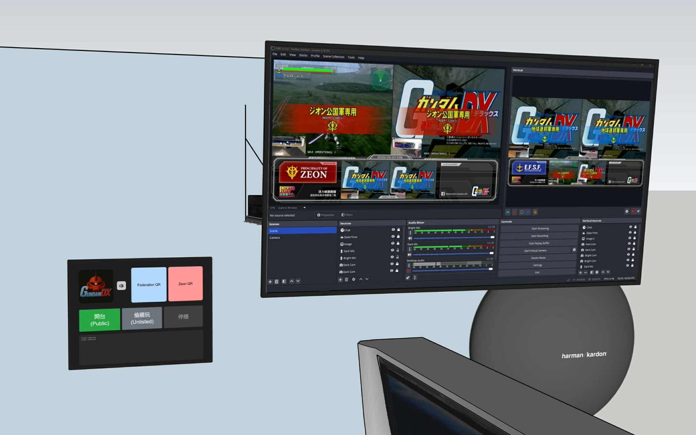

# Gundam DX Stream Suite

<p align=center></p>



Gundam DX Stream Suite is an automation tool for live streaming "Mobile Suit Gundam: Federation vs. Zeon DX" arcade games. It's designed for a dual-perspective setup (Federation and Zeon), automating everything from stream creation to score tracking.

### Watch our live stream: [荔枝角 GundamDX on YouTube](https://www.youtube.com/@%E8%8D%94%E6%9E%9D%E8%A7%92GundamDX)

###### **Disclaimer:** This tool is built for a specific arcade streaming setup. Using it for other games or on different systems will require technical adjustments.

## Key Features

- **Automated Dual Streaming:** Automatically creates and manages two separate YouTube live streams (one for each faction) with a single click.
- **AI-Powered Scorekeeping:** Uses screen recognition (OCR) to automatically detect the winner of each match, keeping track of scores, win rates, and streaks.
- **Unified Chat & TTS:** Combines the live chat from both streams into one view. Viewers can use chat commands like `!say` to have their messages read out loud by a Text-to-Speech voice.
- **Simple Control Panel:** A touch-friendly web interface to start/stop streams, view logs, and control features like TTS.

## Getting Started

### Prerequisites

- **Node.js**
- **[openclaw/wacli](https://github.com/openclaw/wacli) v0.12.0 or newer** (install with `brew install openclaw/tap/wacli` on macOS/Linux, or put the Windows release binary on `PATH`)
- **FFmpeg** (for video processing)
- **OBS Studio** with the WebSocket and Aitum Vertical plugin enabled.
- A **Google Cloud Project** with the YouTube Data API enabled to allow the tool to manage your streams.

### Setup

1.  **Download the code:**
    ```bash
    git clone https://github.com/vkedwardli/GundamDXStreamSuite.git
    cd GundamDXStreamSuite
    ```
2.  **Install dependencies:**
    ```bash
    npm install
    ```
3.  **Configure:**
    - Create a `.env` file by copying from `.env.example`.
    - Fill in your details, such as Google API credentials and your OBS WebSocket password.
4.  **Authorize and test WhatsApp:**
    - Set `WA_TEST_GROUP_ID`, then run `npm run test:whatsapp`.
    - Scan the QR code from WhatsApp > Linked Devices when prompted. The test uses an isolated `.wacli/session-diagnostic-test` store and sends only to the testing group.
    - Outbound WhatsApp calls are allowlisted to `WA_PUBLIC_GROUP_ID` and `WA_TEST_GROUP_ID`; direct/new recipients and other groups are rejected.
5.  **Authorize with YouTube:**
    - Run the app for the first time: `node index.js`.
    - Follow the on-screen link to log in with your Google account and allow access. A `token.json` file will be saved for future use.

### YouTube chat diagnostics and reauthorization

WhatsApp commands enter the bridge in `index.js`, are saved and dispatched by
`whatsappYouTubeBridge.js`, and reach `youtube.liveChatMessages.insert` through
`youtubeService.js` and `youtubeChatDelivery.js`. Sending uses OAuth, not an API
key. `CLIENT_ID` and `CLIENT_SECRET` in `.env` identify the Google OAuth client;
`token.json` holds the authorized account's access and refresh tokens.

On the streaming PC, from the application directory, run:

```bash
npm run diagnose:youtube -- PdYfjzdHR_g
```

Use the current target video ID. This checks token refresh, the authorized
YouTube channel, and the video's active chat without posting or changing the
saved credentials. Successful lookups do not prove permission to post.
`invalid_grant` during refresh calls for reauthorization. Ordinary access-token
expiry is handled automatically by the Google client while the refresh token
remains valid. External OAuth apps in Google's **Testing** publishing status
receive refresh tokens that expire after seven days for the YouTube scope.

To renew access, stop the Node app, move `token.json` to a private backup location
outside the repository, and start the app again. Open the printed authorization
link **on the streaming PC**, sign in to the intended YouTube channel, and grant
access. The callback at `http://localhost:3000/oauth2callback` saves a new
`token.json`; the authorization URL requests offline access and fresh consent.
If replacing the OAuth client itself, update `CLIENT_ID` and `CLIENT_SECRET`
in `.env` first and register that exact callback URL in Google Cloud Console.
An API key cannot authorize chat posting.

Delivery diagnostics are always enabled. Failures log the operation (`lookup`
or `insert`), HTTP status, API status, reason, and a single-line API message
limited to 200 characters. Notification updates do not repeat the diagnostic
summary. The outbox journal retains the full API error details, including chat
ID and message length for insert failures. Request credentials are excluded.
`ERROR_UNSPECIFIED` alone does not identify token expiry, moderation, or another
cause; inspect these details before deciding how to recover.

An `ERROR_UNSPECIFIED` rejection sends a quoted Cantonese reply to the original
WhatsApp command explaining that delivery failed for an unknown reason and the
user can try later. An uncertain submission instead says delivery could not be
confirmed, without encouraging a duplicate post. Retryable failures wait until
safe retries are exhausted before notifying. Replies use the existing journal
to prevent duplicates across restarts and redelivery, and expire after ten minutes.
Previously rejected commands remain rejected after reauthorization.

References: [YouTube authorization](https://developers.google.com/youtube/v3/guides/authentication),
[OAuth token expiry](https://developers.google.com/identity/protocols/oauth2#expiration),
[OAuth reauthorization](https://developers.google.com/identity/protocols/oauth2/web-server#handlingresponse).

### Running the Application

```bash
node index.js
```

Once running, open the control panel in your browser to manage the stream.

Restarting the YouTube chat readers can refresh the chat HTML with recent
history. Each comment can trigger WhatsApp forwarding and TTS only once per
broadcast during the Node session, including across chat stop/start. After a
Node restart, comments timestamped before startup remain display-only. Replayed
comments still confirm WhatsApp-to-YouTube delivery, but do not queue speech or
leave captions waiting for audio.

Stop always attempts local chat, viewer polling, OCR, and overlay cleanup, even
when the OBS control connection is lost or OBS is already stopped. It retries
the connection, requests stream shutdown when possible, and waits for the OBS
process-close command and exit check. A failed step does not skip the other
cleanup steps. After the close command, it allows up to 15 seconds for process
cleanup, polling every 500ms and proceeding as soon as exit is confirmed. The
window disappearing alone does not confirm process exit; pending process IDs
and elapsed wait time are logged. If shutdown cannot be confirmed, the control
panel keeps Stop available for retry and blocks Start until cleanup succeeds. Delayed startup
and chat retry work cannot resume polling after Stop.

While streaming, open **停播** and choose **重開直播** to recover capture hardware:
stop the OBS stream and virtual camera, close OBS, relaunch it, then restart the
stream, virtual camera and OCR. This keeps the current YouTube IDs/QR links,
scores, chat readers and forwarding deduplication. It skips the normal Stop
cooldown, farewell and new-stream announcements, and makes no YouTube API changes.
Stream controls are locked during recovery, including on reconnected panels.
If recovery fails, retry **重開直播** or use **停播** for full cleanup. A full Stop
request cancels recovery and waits for any in-flight OBS launch before cleanup.
This is a quick encoder restart: if OBS takes too long to recover, YouTube can
still end the broadcasts; recovery never creates replacement broadcasts.

On the touch panel (`control.html`), double-tap the Gundam icon to show the
Wi-Fi QR code. Scan it to join the hidden **LCKDX** network, or connect manually
using WPA/WPA2 and password **clsclscls**. The dialog hides automatically after
10 seconds. Close it sooner with **關閉**, tap
outside it, or press Escape. Keyboard users can focus the icon and press Enter
or Space to open it.

The hotspot credentials are intentionally public. The QR image is bundled at
`images/lckdx-wifi.svg`, so displaying it needs no external QR service. Its
[Wi-Fi payload](https://github.com/zxing/zxing/wiki/Barcode-Contents#wi-fi-network-config-android-ios-11)
is `WIFI:T:WPA;S:LCKDX;P:clsclscls;H:true;;` (`H:true` marks the SSID as hidden).
If the network changes, replace the SVG with a QR code for the new credentials
and update the network name shown in `control.html`.

Scores and winning streaks are saved to `score.txt` beside `index.js` after each
change, together with the save date/time (UTC and local), draws, and total matches.
Keep this runtime file when deploying; it is ignored by Git.

WhatsApp login and stream-link announcements do not gate stream startup. New
stream links are sent in the background after OCR starts; if WhatsApp is not
ready, the announcements are skipped. Hourly announcements are scheduled before
optional desktop/speaker setup finishes.

On a Node startup from **06:00 inclusive to before 12:00 noon Hong Kong time**, the app sends one morning
weather brief to `WA_PUBLIC_GROUP_ID` after WhatsApp becomes ready, regardless of
stream visibility or whether a stream has started. It uses the supplied HKO
formatter: temperature versus yesterday, current Observatory temperature, today's
forecast when available, active warnings, and high visibility at Central (falling
back to Sai Wan Ho). Unavailable optional readings are omitted.
HKO's nine-day feed can start at tomorrow after its late-morning update. The
formatter therefore also fetches the local forecast (`flw`) for today's latest
description, and saves any matching same-day nine-day entry under
`weather-announcements/forecasts/YYYYMMDD.json`. Noon can reuse that entry for
the temperature range and significant-rain probability, labelled `早前預報`.
If no same-day entry was saved (for example, the first startup is after the feed
has rolled over), those fields say `暫未有資料`; tomorrow's forecast is never
shown as today's. The local description is used only for a fresh, same-day
bulletin covering today, including `下午及今晚` after the noon update.
Immediately below the current temperature, `體感溫度約 …°C` shows the
[NWS heat index](https://www.wpc.ncep.noaa.gov/html/heatindex_equation.shtml),
calculated from fresh Observatory temperature and relative humidity and rounded
to one decimal place. It uses the simple estimate averaged with temperature
below 80°F, and the Rothfusz regression plus humidity adjustments otherwise.
This estimates shaded heat conditions, not wind chill or direct sunlight; the
line is omitted when either input is unavailable, stale, or invalid.
Overnight restarts (00:00–05:59), including the previous operation day's 1am
session, skip the morning edition and do not queue an announcement for 6am.

The app also schedules a **12:00 noon Hong Kong time** announcement every day
while Node is running, headed `香港中午天氣`. This is independent of morning
startup and stream visibility. If WhatsApp or HKO is unavailable, the noon
edition can recover until 13:00; a restart during that hour catches up if it
hasn't already been attempted. Later starts wait for the next day's noon run.

Weather work runs in the background. Logs prefixed `WhatsApp morning weather
YYYYMMDD:` or `WhatsApp noon weather YYYYMMDD:` report waiting, fetching, sending,
sent (with message ID), skipped, or failure. HKO fetch failures retry every five
minutes within the edition's window. The morning edition expires at noon, and
the noon edition expires at 13:00. Shutdown cancels the daily job and pending
weather work.

Daily send records live in `weather-announcements/` within the configured wacli
session directory and survive Node restarts. Keep this folder during deployment.
Morning uses `YYYYMMDD.json`; noon uses `YYYYMMDD-noon.json`, allowing both editions
on the same day. A send attempt is recorded before dispatch; failed or uncertain
sends are logged and that edition is not automatically repeated that day, avoiding duplicate public messages after
a crash or lost acknowledgement. A returned message ID confirms WhatsApp accepted
the send, not that every group member received or read it. This announcement
checks outbound WhatsApp delivery; it does not verify the incoming YouTube bridge.

While WhatsApp sync is running, the adapter checks local authentication every
15 seconds using a read-only command. If wacli reports `authenticated: false`,
the adapter stops its own sync process to release the store and starts QR login
without restarting Node or OBS. Failed QR attempts retry. A failed status read
is logged and does not itself trigger reauthentication. Detection depends on
wacli recording the remote logout in its local session store; an old device row
that still reports authenticated cannot prove the phone still lists the device.

Use Ctrl+C for a deployment restart: one shutdown handler stops OCR and waits
for the app's WhatsApp child processes and outbox cleanup, leaving OBS running.
Force-closing the console can bypass this cleanup. Do not delete the WhatsApp
session database or lock files to work around a running process.

On Windows, `start.bat` disables QuickEdit for its console using
`disableQuickEdit.ps1`, without changing registry settings. This reduces the
risk of pausing the app while selecting console text. If all features freeze,
press Escape in that console first. If it resumes immediately, console selection
was involved. This is a diagnostic check, not proof that all hangs have that
cause. Direct `node index.js` launches do not apply the console setting.

Relevant references: [wacli sync](https://github.com/openclaw/wacli/blob/v0.12.0/cmd/wacli/sync.go),
[read-only auth status](https://github.com/openclaw/wacli/blob/v0.12.0/cmd/wacli/auth_status_readonly.go),
[Windows console modes](https://learn.microsoft.com/en-us/windows/console/setconsolemode).

For a deployment restart, leave OBS streaming, close and restart Node, then click
Live for the current stream visibility. When OBS is already streaming, the app
restores `score.txt` before OCR resumes. Starting Node or opening the control page
does not overwrite the saved file. The restore happens once per Node process;
starting a fresh OBS stream does not load old scores. A missing or invalid file is
logged and the current scores are used instead. The streak inactivity window starts
again on resume; the last real result timestamp is retained to prevent a quick
restart from bypassing the existing duplicate-result cooldown.
Matches played while Node is stopped cannot be counted. On the first deployment
of this feature, use the manual options below if there is no saved file yet.

To manually override the saved scores, pass the previous scores and current
winning streak. For example, Federation 25, Zeon 77, with Zeon on six consecutive wins:

```bash
node index.js --fed-score 25 --zeon-score 77 --zeon-streak 6
```

On Windows, the launcher accepts the same options:

```cmd
start.bat --fed-score 25 --zeon-score 77 --zeon-streak 6
```

The four options are `--fed-score`, `--zeon-score`, `--fed-streak`, and
`--zeon-streak`. Omitted values default to zero. Values must be non-negative whole
numbers; only one faction can have a positive streak, and its streak cannot exceed
its score. Both `--fed-score 25` and `--fed-score=25` work.

These options restore the scoreboard and the state used by score announcements.
The six-minute streak inactivity window starts again when Node starts. Historical
draws are not restored by these manual options; the initial match count is the sum
of both scores. Explicit launch options take priority over `score.txt`. With no
options, a fresh Node process starts at zero unless it resumes an ongoing OBS
stream. The next detected result continues from the selected values.

## For Developers

This project is highly customizable but contains hardcoded values specific to the original setup (e.g., screen coordinates for OCR in `score.js`, Windows paths in `systemUtils.js`). If you plan to adapt this project, you will need to modify these values to fit your environment.

## License

This project is licensed under the GNU General Public License v3.0 (GPL-3.0).
